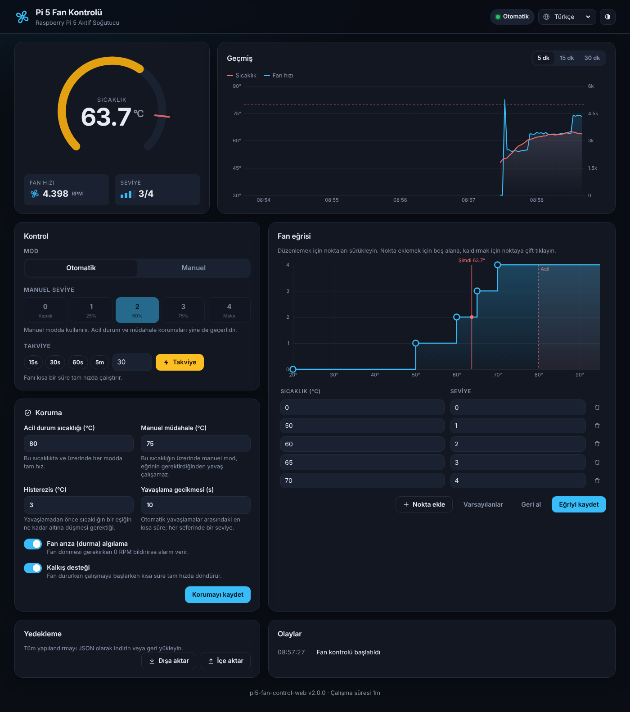
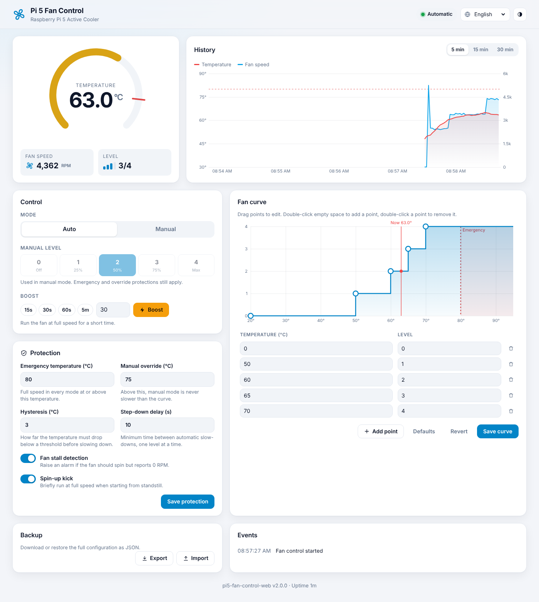

# Raspberry Pi 5 Fan Control Web

[Türkçe](#türkçe) · [English](#english)

<p align="center">
  
</p>
<p align="center">
  
</p>

---

## Türkçe

Raspberry Pi 5 resmi aktif soğutucusu (PWM fan) için web paneli. Fanı sıcaklık eğrisine göre otomatik ya da elle yönetir; fanı ve Pi'yi korumak için birçok güvenlik kuralı içerir.

### Özellikler

- **Canlı panel:** dairesel sıcaklık göstergesi, RPM, fan seviyesi, son 30 dakikanın sıcaklık/RPM grafiği
- **Sürüklenebilir fan eğrisi:** noktaları grafik üzerinde sürükleyin ya da tablodan düzenleyin
- **Otomatik / manuel mod**, süreli **takviye (boost)**
- **10 dil:** Türkçe, English, Deutsch, Français, Español, Italiano, Português, Русский, 中文, 日本語 (tarayıcı dilinden otomatik seçilir)
- **Açık / koyu tema**, mobil uyumlu, harici CDN gerektirmez (internetsiz ağda çalışır)
- **İsteğe bağlı şifre koruması**, ayarları **JSON olarak dışa / içe aktarma**

### Koruma özellikleri

| Koruma | Ne yapar |
|---|---|
| Termal acil durum | Sıcaklık acil durum eşiğine (varsayılan 80 °C) ulaşınca **her modda** fan tam hıza geçer; 5 °C soğuyana kadar öyle kalır. |
| Manuel mod koruması | Manuel modda düşük bir seviye unutulsa bile, belirli sıcaklığın (varsayılan 75 °C) üzerinde fan eğrinin gerektirdiğinden yavaş dönmez. |
| Sensör fail-safe | Sıcaklık okunamazsa (veya anlamsız bir değer gelirse) fan tam hıza alınır ve alarm verilir. |
| Histerezis | Fan bir eşiği geçince hemen hızlanır, ancak sıcaklık eşiğin birkaç derece altına düşünce yavaşlar. Sınırda sürekli aç/kapa olmaz. |
| Kademeli yavaşlama | Otomatik modda fan her seferinde bir seviye ve en az belirli aralıkla (varsayılan 10 sn) yavaşlar. Hızlanma her zaman anında olur. |
| Kalkış desteği | Duran fan düşük bir seviyeye geçerken 2 sn tam hızda döndürülür; motor güvenle kalkar. |
| Fan arıza algılama | Fanın dönmesi gerekirken RPM 0 kalırsa alarm verilir (kablo kopması, sıkışma). |
| Eğri doğrulama | Sıcaklık artarken seviyesi düşen bir eğri kaydedilemez; tüm girişler sunucuda doğrulanır. |
| Kernel'e güvenli devir | Başlarken termal bölge `user_space` yöneticisine alınır (kernel fanı ezmesin diye). Uygulama kapanınca fan tam hıza alınır ve kontrol kernel'in kendi yöneticisine geri verilir. |
| Bozulmayan ayarlar | Ayarlar atomik yazılır; elektrik kesintisinde yarım dosya kalmaz. Bozuk bir dosya yedeklenir ve varsayılanlarla devam edilir. |
| Hata dayanıklılığı | Kontrol döngüsünde beklenmeyen bir hata olursa fan tam hıza alınır ve döngü çalışmaya devam eder. |

> Not: Raspberry Pi'nin kendi firmware'i 80–85 °C civarında CPU'yu yavaşlatmaya başlar; bu panel ondan bağımsız ek bir katmandır.

### Kurulum

#### Docker (önerilen)

```bash
mkdir -p ~/pi5-fan && cd ~/pi5-fan
curl -O https://raw.githubusercontent.com/dikeckaan/pi5-fan-control-web/main/docker-compose.yml
docker compose up -d
```

veya tek komutla:

```bash
docker run -d --name fan-web --restart unless-stopped --privileged \
  -p 5000:5000 -v "$PWD/data:/app/data" \
  dikeckaan/pi5-fan-control-web:latest
```

Panel: `http://<raspberry-pi-ip>:5000`

#### Doğrudan Python ile

```bash
pip install -r requirements.txt
sudo python3 app.py
```

#### Ortam değişkenleri

| Değişken | Varsayılan | Açıklama |
|---|---|---|
| `FAN_PASSWORD` | – | Belirlenirse panel şifre ister. |
| `FAN_PORT` / `FAN_HOST` | `5000` / `0.0.0.0` | Dinlenecek port ve adres. |
| `FAN_DATA_DIR` | `data` | Ayarların (`config.json`) ve oturum anahtarının tutulduğu klasör. |
| `FAN_SECRET_KEY` | otomatik | Oturum çerezlerini imzalayan anahtar (verilmezse üretilip saklanır). |
| `FAN_SIMULATE` | – | `1` ise gerçek donanım yerine simülatör kullanılır (geliştirme / demo). |
| `FAN_LOG_LEVEL` | `INFO` | Log seviyesi. |

#### v1'den yükseltme

Eski `config.json` dosyanız ilk açılışta otomatik olarak `data/config.json` konumuna taşınır; yeni güvenlik ayarları varsayılan değerleriyle eklenir. Docker kullanıyorsanız yeni `docker-compose.yml` dosyasındaki `./data:/app/data` bağlamasını kullanın.

### Geliştirme

```bash
pip install -r requirements-dev.txt
pytest                      # testler
FAN_SIMULATE=1 python3 app.py   # Pi olmadan simülatörle çalıştır
```

Yeni bir dil eklemek için `static/i18n/en.json` dosyasını kopyalayıp çevirin ve `static/js/i18n.js` içindeki `LANGUAGES` listesine ekleyin.

### Dosya yapısı

- `app.py` – giriş noktası
- `pifan/hardware.py` – sysfs erişimi ve simülatör
- `pifan/config.py` – ayar doğrulama ve atomik kayıt
- `pifan/controller.py` – kontrol döngüsü ve tüm koruma kuralları
- `pifan/web.py` – HTTP API, şifre koruması, güvenlik başlıkları
- `templates/`, `static/` – arayüz (vanilla JS, canvas grafikleri, çeviriler)
- `tests/` – pytest testleri

---

## English

A web panel for the official Raspberry Pi 5 Active Cooler (PWM fan). It drives the fan from a temperature curve or manually, with a set of safety rules that protect both the fan and the Pi.

### Features

- **Live dashboard:** temperature gauge, RPM, fan level, 30-minute temperature/RPM history
- **Draggable fan curve:** drag points on the chart or edit them in the table
- **Auto / manual mode**, timed **boost**
- **10 languages:** Türkçe, English, Deutsch, Français, Español, Italiano, Português, Русский, 中文, 日本語 (picked from the browser language)
- **Light / dark theme**, mobile friendly, no external CDN (works on offline networks)
- **Optional password protection**, **JSON config export / import**

### Protection

| Protection | What it does |
|---|---|
| Thermal emergency | At the emergency temperature (default 80 °C) the fan runs at full speed **in every mode** until the SoC is 5 °C cooler. |
| Manual mode guard | Above a set temperature (default 75 °C) manual mode never runs slower than the curve, even if a low level was left on. |
| Sensor fail-safe | If the temperature cannot be read (or is implausible) the fan goes to full speed and an alarm is raised. |
| Hysteresis | The fan speeds up as soon as a threshold is crossed but only slows down once the temperature is a few degrees below it, so it does not hunt around a threshold. |
| Gradual step-down | In auto mode the fan slows down one level at a time with a minimum delay (default 10 s). Speeding up is always immediate. |
| Spin-up kick | A stopped fan gets 2 s at full speed when starting at a low level so the motor reliably starts. |
| Stall detection | Alarm when the fan should spin but reports 0 RPM (broken cable, blocked blades). |
| Curve validation | A curve whose level drops as the temperature rises cannot be saved; every input is validated server-side. |
| Safe kernel handover | On start the thermal zone is switched to the `user_space` governor so the kernel does not overwrite the fan level. On exit the fan is set to full speed and control is handed back to the kernel governor. |
| Crash-safe config | Settings are written atomically; a power cut never leaves a half-written file. A corrupt file is backed up and defaults are used. |
| Fault tolerance | An unexpected error in the control loop sets the fan to full speed and the loop keeps running. |

> The Raspberry Pi firmware itself starts throttling the CPU around 80–85 °C; this panel is an additional layer on top of that.

### Install

#### Docker (recommended)

```bash
mkdir -p ~/pi5-fan && cd ~/pi5-fan
curl -O https://raw.githubusercontent.com/dikeckaan/pi5-fan-control-web/main/docker-compose.yml
docker compose up -d
```

or:

```bash
docker run -d --name fan-web --restart unless-stopped --privileged \
  -p 5000:5000 -v "$PWD/data:/app/data" \
  dikeckaan/pi5-fan-control-web:latest
```

Open `http://<raspberry-pi-ip>:5000`.

#### Plain Python

```bash
pip install -r requirements.txt
sudo python3 app.py
```

#### Environment variables

| Variable | Default | Description |
|---|---|---|
| `FAN_PASSWORD` | – | Require this password to use the panel. |
| `FAN_PORT` / `FAN_HOST` | `5000` / `0.0.0.0` | Listen port and address. |
| `FAN_DATA_DIR` | `data` | Folder for `config.json` and the session key. |
| `FAN_SECRET_KEY` | generated | Key that signs session cookies (generated and stored if not set). |
| `FAN_SIMULATE` | – | `1` uses a simulator instead of real hardware (development / demo). |
| `FAN_LOG_LEVEL` | `INFO` | Log level. |

#### Upgrading from v1

An existing `config.json` is moved to `data/config.json` on first start, and the new safety settings are added with their defaults. With Docker, use the `./data:/app/data` mount from the new `docker-compose.yml`.

### Development

```bash
pip install -r requirements-dev.txt
pytest
FAN_SIMULATE=1 python3 app.py   # run without a Pi
```

To add a language, copy `static/i18n/en.json`, translate it and add it to `LANGUAGES` in `static/js/i18n.js`.
